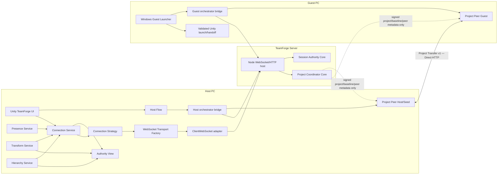

# TeamForge current architecture

This document describes the **current as-built architecture and trust boundaries** of TeamForge source.

It intentionally avoids owning volatile release-readiness, candidate-tag, tool-version, or test-run state:

- current capability/readiness → [STATUS.md](STATUS.md)
- exact runtime/tool/protocol/release selections → [`../release-contract.json`](../release-contract.json)
- packaged artifact identity → [`../builds/README.md`](../builds/README.md)
- planned direction → [ROADMAP.md](ROADMAP.md)

Historical phase/ADR records remain useful context, but they do not override this document when later source changed the as-built structure.

## Runtime topology

The configured TeamForge Server WebSocket is the implemented realtime authority route. Project payload bytes move directly between Project Peer processes over HTTP and do **not** pass through the TeamForge Server or Project Coordinator.

The normal packaged Windows Host/Guest path uses a manifest-pinned bundled Runtime. System Node/npm are source-development requirements rather than normal end-user prerequisites.

## Major process responsibilities

| Layer / process | Owns | Must not own |
| --- | --- | --- |
| Unity UI / Host Flow | User-facing Host controls, baseline review, endpoint input, diagnostics, safe workflow state | Server authority transitions, raw socket implementation, bypass of Project verification |
| Collaboration services | Presence sampling; Transform/Hierarchy observation and application; Scene/Undo safety behavior | Server-authoritative Revision/Lock decisions |
| Authority View | Observed Session Revision, Lock registry, capabilities, connection identity | Persistent state or authoritative transitions |
| Connection Service | Lifecycle, reconnect/backoff, handshake, main-thread dispatch, protocol routing | Hidden second realtime route or server authority |
| Connection Strategy | Ordered connection attempt for the configured TeamForge Server endpoint | Raw transport implementation or authority state |
| Transport Factory / adapter | Reliable ordered WebSocket text-channel construction/execution | Protocol routing, reconnect policy, Scene behavior |
| Server host | HTTP health/upgrade, Bearer auth, WebSocket/JSON I/O, rate/buffer/heartbeat timers, effect execution | Project payload storage/relay or authority rules duplicated outside the cores |
| Session Authority Core | Presence membership, lock leases, shared Revision, Transform, Hierarchy, Tombstones, conflict/idempotency and ordered effects | HTTP, WebSocket, JSON parsing or host timers |
| Project Coordinator Core | Project/Owner/publisher/baseline/peer coordination metadata and ordered effects | Manifest/File/Chunk bytes, filesystem payload storage or realtime Scene authority |
| Host orchestrator / Project Peer Host | Preflight, explicit publish/start lifecycle, baseline/Invite coordination, direct Seed process | Realtime authority or silent baseline replacement |
| Transfer Core | Source selection, verified resume, concurrency, pacing, retry/backoff/failover, final verification and progress | Trust bypass or activation policy hidden in transport details |
| Transfer Source adapter | Descriptor/Manifest/Inventory/Chunk lookup and transport-specific error normalization | Activation policy, trust replacement or silent alternate transport |
| Project Peer storage/backend | Manifest/chunk/hash processing, staging, immutable Active revisions, atomic current-pointer movement | Realtime authority or destructive overwrite of arbitrary user projects |
| Windows Guest Launcher | Invite/access-code input, trust UI, verified bundled-Runtime execution, managed destination, final Unity handoff | Project authority, signature/hash bypass or arbitrary shell launch |
| Diagnostics / recovery UX | Stable user-facing explanations, redacted bounded diagnostics, state-driven recovery actions | Persistent secret history or bypass of trust/activation/baseline checks |
| Path resilience layer | Managed path selection and approved short execution-path preparation | Weakening containment, identity, hash, trust or final handoff validation |

## Dependency-direction invariants

- The Server host composes authority/coordinator cores; it should not duplicate their state-transition rules.
- Server/Coordinator Project state is metadata-only and memory-resident. The Server does not become a Project payload store.
- Unity Transform and Hierarchy services consume observed authority state rather than becoming independent authority stores.
- `TeamForgeConnectionService` owns lifecycle/routing around the configured connection path; it does not own a hidden fallback authority route.
- Project transfer stays behind the Project Transfer source boundary. The current payload route is direct Project Peer HTTP.
- Packaged Host/Guest bridges execute from a manifest-pinned Runtime. Developer CLIs remain development/diagnostic paths, not the normal fresh-Guest UX.
- Diagnostics/recovery must preserve trust, activation, identity and Scene-baseline fail-closed behavior.
- Path-resilience work may change execution/workspace path handling but must not silently change authority, identity, protocol or trust rules.

## Object identity and authority contract

- Saved loaded Scene objects use stable Unity identity (`GlobalObjectId`) as the default saved-object wire/baseline identity.
- An authoritative logical `tf:` identity becomes canonical only after the current connection epoch's Hierarchy authority binds it.
- Local alias/cache data may help resolve an object but cannot itself grant session authority or replace a saved object's authoritative outgoing identity.
- Reconnect or connection replacement clears current-session logical authority; persisted aliases remain hints until the new authoritative snapshot/live state confirms the binding.
- When Hierarchy is negotiated, dependent Transform/Lock authority waits for the required authoritative identity/snapshot state.
- Identity/baseline mismatches fail closed rather than silently falling back to a name, Hierarchy path, sibling index or guessed object.
- Presence, Transform, Lock and Hierarchy should use the same authority-canonical identity model rather than maintaining incompatible fallback schemes.

Historical identity/authority matrices under the phase records remain evidence for their recorded implementation state, not a competing current contract.

### WP6 Component identity preparation — not yet synchronized

The optional, independent `server/src/component-foundation.mjs` pre-wire validator is a **testable research foundation**, not an implemented wire command or supported Component/Inspector feature. It cannot mutate an authoritative Session or Unity Scene, and is not imported by the realtime dispatch path.

The identity-only candidate rules deliberately fail closed: a clean baseline references a **saved Unity Component GlobalObjectId** and an **existing authoritative Scene/GameObject**, not a type name, Component array index, object display name or local Instance ID. Duplicate identities are rejected even if Components share a type or appear under different GameObjects. Candidate acceptance also requires the current Hierarchy revision, an explicit allowed-type set and aggregate safety limits (a hard prototype ceiling of 2,048 identities and 256 KiB of serialized UTF-8 identity fingerprint bytes, regardless of a larger supplied count policy); values, property paths, arrays, references, Prefab overrides and logical session-created Component identities are not accepted.

A second inert module, `server/src/component-property-foundation.mjs`, uses **locally prepared, same-Session** identity candidates (not client-provided lookalikes or a snapshot from another Session) and the current authoritative Hierarchy revision to inspect exact, policy-allowlisted `SerializedProperty` paths for only `boolean`, 32-bit integer, bounded finite `float` and bounded `Vector3` values. It rejects unknown shapes, arrays/indexed/nested paths, reference/managed-reference/Prefab/script paths, unknown Component IDs, type/path mismatches, and stale owner/revision before producing a frozen, non-mutating result. The runtime has **no default allowed type or property path**; a caller must opt in explicitly for pre-wire testing. Value bounds and path grammar are prototype conservatism, **not a promised public protocol**. An independent follow-up now requires **exact typed policy descriptors**, with explicit finite numeric `minimum`/`maximum` or a non-negative `Vector3.maximumAbsolute` bound. A type match alone never grants a numeric property unlimited acceptable values (for example, a negative Collider radius candidate is rejected by its explicit prototype range). This is still only pre-wire validation; real Unity per-property semantics and server authority remain future work.

A third **pre-wire only** validator, `server/src/component-structure-foundation.mjs`, assesses *proposed* add/remove intent without reserving an identity, mutating a Session/Scene or enabling any network capability. It requires the same-Session prepared identity baseline and exact current revision/owner, an explicit bounded Component-type policy, per-owner multiplicity/minimums and declared dependencies. It rejects removal of the last required instance, automatically implied dependency additions, unknown metadata and protected Transform/RectTransform types. Add intents carry a **non-authoritative pending logical `tf:c:` ID**; remove intents target an existing saved GlobalObjectId. The policy metadata in these isolated tests is **hypothetical** and must be corroborated before production. `TeamForgeGlobalObjectIdProbeTests.cs` now exercises Editor-only dependency insertion with `RequireComponent`, checks `DisallowMultipleComponent` metadata, observes local Undo/Redo for a Collider value, and distinguishes a Prefab Asset from an instantiated Prefab. These are narrow probes, **not** a complete policy extraction, Prefab Stage editing support, server-side lock/replay proof or authority repair contract. An additional automated Editor probe opens an actual Prefab Stage and checks that the existing Phase 2 Transform selection authority **rejects** that staged GameObject as `PrefabStage` before baseline tracking; cleanup always returns the Editor to the main Stage. This is an explicit unsupported-context guard, not a WP6 Prefab sync implementation. An additional Editor-only EditMode probe round-trips a local Collider through `Undo.AddComponent`, Undo/Redo and `Undo.DestroyObjectImmediate` restoration, without treating the Undo stack as a cross-client authority ledger. Future production checks must independently derive allowed Component metadata and handle failure/Undo/Prefab boundary cases. Neither a validated proposal nor a reused pending ID confers lock ownership, ordering, replay/idempotency or authority.

The **disconnected** `server/src/component-operation-preflight.mjs` classifies proposed structural and typed property operation IDs using the existing **Session-wide** operation-history namespace shared by Hierarchy and Transform. Different fingerprints with the same ID fail closed, including cross-kind collisions; matching prior records are inspected before current base-Revision refusal. A property fingerprint binds the authenticated actor, Scene/object/Component/type identity, base Revision, exact path, value kind and value. Vector3 axes use canonical ordering; numeric `-0` and `0` have the same JSON value semantics, while distinct finite values and kinds remain distinct. A **type-correct, complete hypothetical applied record** must match all those fields and represent a subsequent server Revision no later than current authority. Cached property values are independently shape-validated before comparison. A matching fingerprint or merely plausible Revision is insufficient. This provisional pre-wire shape **does not send an ACK, reserve an ID, grant locks, register history, mutate authority or enable live Component protocol**. An observed prior record never authorizes another Scene write.

The **disconnected** `server/src/component-authority-preflight.mjs` first checks the **existing server Session's current registered connection**, then performs read-only retry classification for either structural or property intents. An unseen intent must pass its same-Session prepared identity baseline and exact structural or typed property policy, then hold an owned unexpired Scene/GameObject lease. Replacement connections cannot inherit the old connection's lease; expiry at the sampled server time is already expired. The preflight never expires, grants or moves locks. Matching committed retries from a currently registered actor are observations before current baseline/policy/lease checks, **without an ACK or a new effect**. Unseen stale revision/Scene/owner/Component mismatches return only a `resnapshot_required` hint, not snapshot bytes or a repair message. `unseen_candidate_with_live_lock` is **not an authorization or commit**: a live command still needs atomic authority rechecks, property snapshots, bounded history semantics, negotiated compatibility and targeted Unity rejection/Undo/reconnect recovery. Protocol v1 has no Component capability.

These are **provisional guardrails**, not a settled WP6 protocol. Before networking or Inspector mutation is enabled, Unity Editor probes must confirm saved Component GlobalObjectId stability, domain/reload and repeated-same-type behavior, and the implementation must define authority, locks, revision/replay/idempotency, Undo/rejection, reconnect convergence, allowed property shapes and limits, snapshot bytes and compatibility. Current realtime Protocol v1 remains unchanged. In addition to pure-contract tests, `server/test/server.test.mjs` now exercises a **real WebSocket Protocol v1 compatibility boundary**: unrecognized proposed `supportsComponentSync` / `supportsInspectorSync` Hello flags cannot enable WP6, unimplemented Component structural/property messages receive `unsupported_message`, and a subsequent supported Hierarchy seed still begins at revision 0. This is a deny-by-default runtime regression, **not** WP6 feature negotiation or a live Component handler. See the baseline regression matrix in `server/test/component-foundation.test.mjs`.

## Realtime authority contract

The Session Authority Core owns the authoritative in-memory collaboration state for the live session:

- Presence membership;
- shared Revision/order;
- lock/lease state;
- retained Transform state;
- supported same-Scene Hierarchy state;
- bounded Tombstones and replay/idempotency protection.

Unity clients observe and apply authority; they do not become authoritative merely because local Editor state differs.

Unsupported or ambiguous edits should remain protected/fail-closed until the relevant synchronization surface has an explicit identity, authority, conflict and recovery contract.

## Project bootstrap, transfer and activation contract

- A fresh packaged Guest begins in the standalone Windows Launcher before a Unity project is open.
- Host Ready produces a signed Collaboration Invite containing separately validated Project-transfer and realtime-session contracts.
- The access code is shared separately and is not embedded into the invite.
- Project payload bytes move directly between Project Peers; the Coordinator carries signed metadata and coordination state only.
- Owner/Publisher identity, signed descriptors/invites, manifest/file/chunk hashes, path policy, staging, immutable Active revisions and final handoff checks fail closed.
- Successful activation creates/selects a verified immutable Active revision and moves only the small current pointer after verification.
- Existing arbitrary user projects are not silently overwritten as a normal activation strategy.
- Publisher/Project trust changes require explicit validation/review rather than silent replacement.

## Runtime and packaging boundary

Generated Runtime payloads, packaged executables, Runtime manifests and release ZIPs are **release artifacts**, not canonical source-tree files.

The exact selected versions and target frameworks belong to [`../release-contract.json`](../release-contract.json). Source documentation should avoid copying those numbers unless the number itself is essential to the explanation.

Source paths that describe packaged layouts such as generated Launcher output describe release candidates, not directories guaranteed to exist in a fresh clone.

## Protocol compatibility boundary

The exact current protocol/schema version selections are recorded in [`../release-contract.json`](../release-contract.json).

Architecturally:

- realtime collaboration uses a reliable ordered WebSocket text channel;
- Project payload transfer uses separate direct HTTP descriptor/manifest/inventory/chunk routes;
- realtime and Project payload transport remain separate responsibilities;
- capability negotiation controls which snapshots/features a client receives;
- adding a new synchronization surface must not silently reinterpret an existing protocol contract in an incompatible way.

## State lifetime

- Server Session Authority state is currently memory-resident.
- Project Coordinator registries are currently memory-resident.
- Unity Authority View is transient to the live connection.
- Project Peer content/staging/immutable Active revisions provide the implemented durable Project-data path.
- Diagnostic history is bounded and current-run oriented.
- Persistent server/session operation history, durable authority snapshots and old-session restart recovery are separate future capabilities rather than implicit current behavior.

## Network and security boundary

- Direct Project Peer HTTP requires actual peer reachability, such as same PC, reachable LAN or managed VPN.
- A two-PC invite must advertise a concrete Guest-reachable Host origin; wildcard/unspecified/loopback addresses are not valid remote Guest destinations.
- Non-loopback listeners require authentication according to the current server/Host policy.
- The shared access-code model is designed for a trusted team/LAN/VPN environment, not as a public-Internet identity system.
- Internet relay/NAT-traversal/discovery capabilities must be treated as separate transport/security work rather than assumed from the word `P2P`.
- Runtime/file/path/identity checks are trust boundaries. Convenience features must not generalize a narrow verified exception into acceptance of arbitrary redirected or untrusted content.

## Supported collaboration boundary

The current supported collaboration model is narrower than arbitrary Unity project synchronization.

General Component/Inspector/Prefab/Asset synchronization, cross-Scene structural collaboration, persistent restart recovery, platform-equivalent launchers and broader Internet transport are tracked through [STATUS.md](STATUS.md) and [ROADMAP.md](ROADMAP.md), not asserted here as current capabilities.

## Architecture decisions

Use [architecture-decisions.md](architecture-decisions.md) for important decisions and their historical context.

A historical decision can remain valuable even after being replaced. Explicitly superseded decisions must not override current source or this as-built architecture.
